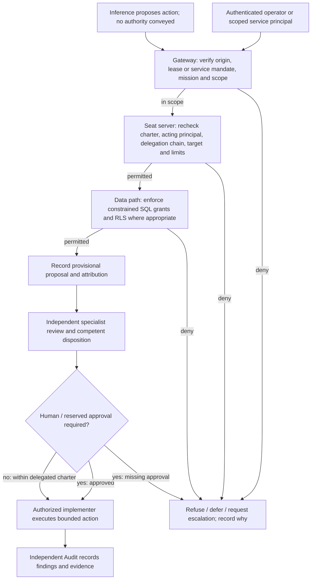

# MCP authorization and corporate decision pathways

**Target control design, not a verified execution trace.** This document translates the owner-provided twenty-seat jurisdiction report into proposed checks at each boundary.

## Checks before a side effect

| Boundary | Required inputs and checks | Failure |
|---|---|---|
| Gateway/operator | Authenticated origin; human lease **or** separately approved machine principal; task/mission; current delegation; budget | Refuse unauthorized routing |
| Receiving seat | Acting seat identity, origin delegation chain, charter version, action allowlist, data and resource scope, signed/authenticated transport | Refuse even if gateway forwarded |
| Database | Constrained SQL principal, permissions, table policies/RLS, input constraints, optimistic version and idempotency keys | Deny write independently |
| Governance | Distinct proposer, reviewer, approver; required committee/human disposition; permitted threshold and effective version | Keep provisional; no self-adoption |
| Execution | Authorized implementer and target, expiry, rollback/replay safety, actual result and verification trail | Failed/pending with evidence, never fabricated success |
| Independent Audit | Separate inspection identity, privacy- and mandate-limited read access, trace of action, findings and management response | Record scope limitation, not invented attestation |

## Proposal-to-deployment example

1. AR encounters evidence and files `adaptation.candidate.submit` as **provisional**.
2. COO collects authorized CTO feasibility, CFO budget and CRO risk assessments; R&D testing requires a **published pre-test Issue/Discussion in the repository being tested**.
3. COO disposes only within its delegated authority. Constitutional/privileged matters require CEO, Board and/or founder approval per the applicable policy.
4. Authorized CTO/implementer executes approved change with independent CISO/DB constraints.
5. Internal Audit examines the **actual** change and approval trail. It cannot approve or deploy its own remediation.

**Security nuance:** A signed bearer token's existence isn't enough; check issuer/audience, expiry, intended action and the original delegation. RLS is not a substitute for least-privilege SQL grants and owner/BYPASSRLS review. Application service mandates may be used for scheduled jobs without pretending an interactive operator lease is active.

## Separate results

Track `operation_status`, `evidence_assessment_status`, `business_outcome_status` and `audit_assurance_status` independently. A JSON-RPC success envelope cannot prove all four.

## No executed test

This diagram and checklist are specifications. Actual enforcement claims require source-backed code review and appropriately pre-registered authorized tests.
