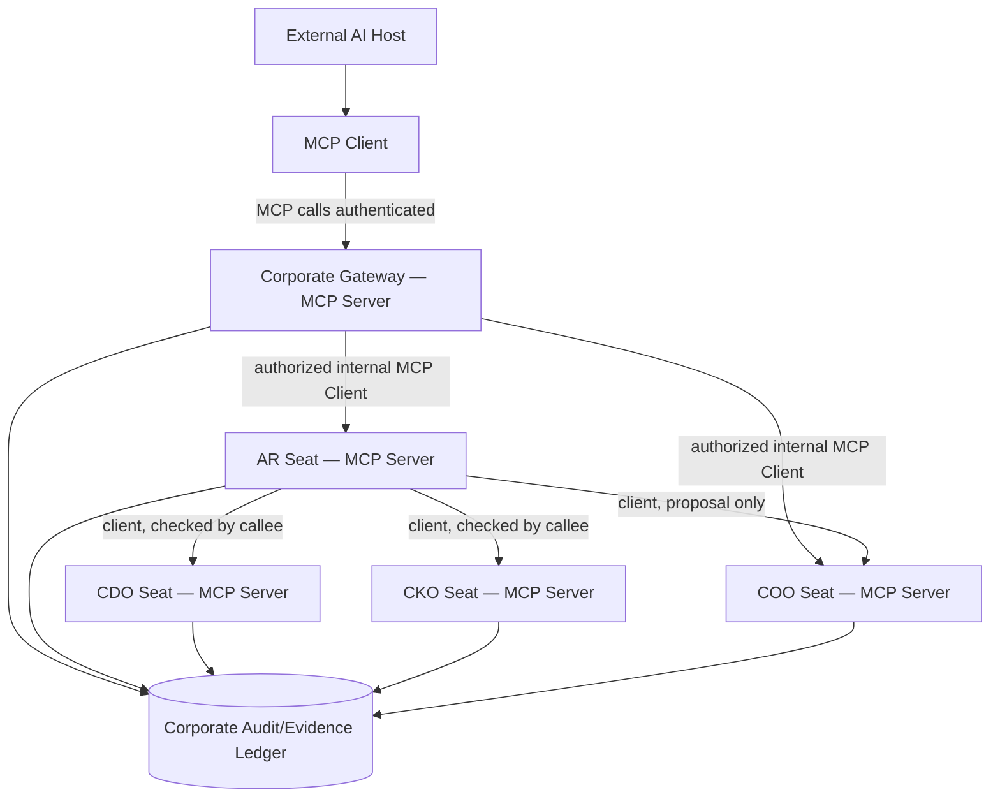

# Proposed MCP interface routing

**Conceptual topology only.** Roles in the diagram are not live endpoints. The gateway may act as both server to external hosts and client to peer offices; AR/COO/etc. may similarly operate both ways. A conceptual seat boundary does not require separate physical hosting.

## Interface contracts

| Call path | Potential operation | Required security result |
|---|---|---|
| External client → Gateway | corporate.status, mission.create | Human-approved client identity, authenticated request, owner/delegation scope |
| Gateway → AR | relation proposal routed to AR | Limited mission and evidence scope; proposal only |
| AR → CDO | integrity assessment | Caller authenticated; CDO verifies policy and returns structural review, not truth |
| AR → CKO | prior context lookup | Access limited to classified mission evidence |
| AR → COO | system-improvement proposal | Routed for independent review; not auto-adopted |
| Audit client → read-only repository adapter | list code/config evidence | Repository-scoped reader; no tests, writes or CI |
| Audit client → audit ledger | record finding | Evidence path, SHA, ruleset, time, uncertainty, stable finding ID |

## Clarify the two dimensions

MCP **client/server** expresses which direction a connection runs. NexusBoard **seat/constitutional role** expresses what duty and authority an actor holds. A single Agent can maintain both an MCP client adapter and MCP server interface without fusing roles.

Each call requires JSON Schema input/output, timeout, refusal behavior, auth scope and per-call revision evidence. A caller-provided `seat_id` is a claim, not authentication. See [registry](tool-proposals.json).
